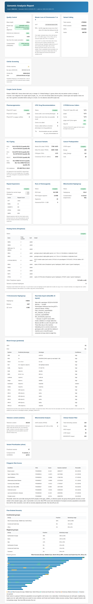

# Step 24: HTML Report

## What This Does

Generates a self-contained HTML dashboard summarizing all pipeline results. Open it in any browser — no internet connection needed.

## Why

The pipeline produces output across many directories in different formats (VCF, TSV, HTML, TXT). This step consolidates everything into a single visual report with color-coded status indicators, variant counts, and key findings.

## Tool

`bin/collect_summary.py` reads every step's output once into `${SAMPLE}/summary.json`, and `bin/render_report.py` renders the report from it. `scripts/generate-report.sh` renders the text report from the same summary, so the two reports cannot disagree about a count. Both are Python standard library only.

## Docker Image

- `PYTHON_IMAGE`

Pinned in `versions.env`; [Image versions](versions.md) lists the current tag.

## Input

All output directories from previous pipeline steps. The script detects which steps have been run. It reads the bash layout (`${GENOME_DIR}/${SAMPLE}`) and the Nextflow one (`--outdir/${SAMPLE}`, for example `roh/`, `coverage/`, `hla/`, `pharmcat/`), so `GENOME_DIR=<outdir> ./scripts/24-html-report.sh <sample>` reports on a Nextflow run.

Two more files, when present:

- `${SAMPLE}/run_manifest.tsv` (`bin/write_manifest.sh`): the pipeline commit, `versions.env`, the digest of every image, the ClinVar file date, the VEP cache, the PCGR and pypgx bundles, whether pgsc_calc's ancestry panel is installed, the IPD-IMGT/HLA release of the `hla.dat` the run used (`run-all.sh` passes it as `HLA_DAT`; without it the one `setup.sh` installs, then the release in the T1K index folder name, and `unknown` when HLA calls exist but no database is found) and the header of each PGS scoring file. `run-all.sh` writes it when a run starts and again just before this step, so an image pulled during the run gets its digest; this step writes one when the sample has none.
- `${SAMPLE}/logs/run_status.tsv`: when the latest `run-all.sh` run started, then one line per step. A step it did not start is `skipped (<reason>)`, for example `skipped (no BAM)` or `skipped (not in TOOLS)`. Once the pipeline has ended, each step it started is one of:
    - `ok`: the pipeline finished. After a pipeline that another step stopped, a step is still `ok` when each of its processes has a task that completed in this run or came from Nextflow's cache (`-resume`), and none was left unfinished.
    - `failed`: one of the step's tasks failed. A report-only tool's failure is ignored by the pipeline, which goes on without it. Ancestry (step 26) is computed inside the PRS run, so it is `failed` when PRS is.
    - `not finished`: the pipeline stopped on another step's failure before this step's tasks ran or ended.
    - `skipped (expansion_hunter failed)`: Stranger (step 9b), which reads ExpansionHunter's calls.

    After a stopped pipeline `run-all.sh` reads these results from `${SAMPLE}/nextflow/process_status.tsv`, which the pipeline writes as it ends: one row per process with its tasks that succeeded, came from the cache, failed, were ignored and were left unfinished. A process belongs to the step whose `--tools` name its own name starts with (`PRS_SUMMARY` belongs to `prs`); Yleaf's processes are named `Y_*`, the SV merge's `SURVIVOR_*`, haplocheck and the chrM extraction (`HAPLOCHECK`, `MITO_EXTRACT_CHRM`) count for step 12, T1K's index build and the KIR pass (`T1K_BUILD`, `KIR_BUILD`, `KIR_TYPING`) count for step 08, and `INDEXCOV` is step 16. A process with no task had not started, so its step is `not finished`; the exception is haplocheck, which reads step 20's Mutect2 calls and gets no task when step 20 did not run or failed. Without that file (Nextflow died before writing it) no step is `ok`.

    Each opt-in step script it ran after the pipeline is `ok` or `failed`. The two reports get no line. After a failed pipeline `run-all.sh` skips the opt-in scripts and still writes this report and the text report.

## Command

```bash
./scripts/24-html-report.sh your_name
```

## Output

`${GENOME_DIR}/${SAMPLE}/${SAMPLE}_report.html` and `${GENOME_DIR}/${SAMPLE}/summary.json`.

The report contains:
- **Quality Control** — mean depth (mosdepth), sex inferred from X/Y coverage (indexcov) against the declared sex, and from step 33: the sex somalier infers from the reads, FREEMIX (VerifyBamID2's estimate of reads from another person) against its warning threshold, and any other sample that is the same person
- **Variant Calling** — total variants, PASS count, SNPs, indels (one pass over the VCF)
- **ClinVar Screening** — hit count by review stars, the ClinVar file date, and the hits table best-reviewed first with a Stars column. The count's badge is yellow when there is a hit and gray when there is none, never green: the screen does not check population frequency, so look up a homozygous P/LP hit in gnomAD before reading much into it
- **Pharmacogenomics** — PharmCAT version and PharmCAT/pypgx conflicts
- **CPIC Drug Recommendations** — genes with a non-normal phenotype, with more than one possible result, not called, called without a function phenotype (`unclassified`, no drug guidance), and a table of the non-normal genes
- **CYP2D6 Across Callers** — pypgx and Cyrius side by side, judged by step 36's rule: a no-call such as `Indeterminate` is not a call, and a Cyrius genotype counts only with Filter `PASS` (otherwise it is shown as not usable, with its Filter). The card says whether the two agree and, with [step 36](36-pgx-consensus.md)'s table, its verdict and reason. The PharmCAT row is the call step 36 passed to PharmCAT, not a third caller: PharmCAT calls no CYP2D6 from a VCF
- **HLA Typing** — T1K alleles per locus, each with its own quality, and the IPD-IMGT/HLA release. A quality of 0 or below is marked low confidence; on HLA-A and HLA-B the card adds that the gene is not passed to PharmCAT. HLA typing from short-read WGS is approximate
- **Polygenic Risk Scores** — each score with its percentile among the most similar reference group, or "raw score only" without the ancestry panel. The caption says that most PRS scores were developed in European-ancestry populations and predict less well for other ancestries, even with an ancestry-adjusted percentile
- **Structural Variants** — Manta, Delly, CNVpytor and the SURVIVOR consensus (2+ callers) counts
- **Cancer Predisposition** — CPSR status and the classification breakdown (read by column name from `${SAMPLE}.cpsr.grch38.classification.tsv.gz`)
- **Repeat Expansions** — key loci repeat counts (HTT, FMR1, C9orf72, ATXN1, DMPK) and, when step 9b (Stranger) ran, every locus whose `STR_STATUS` is `pre_mutation` or `full_mutation`, whichever locus it is. A locus outside Stranger's catalog has no status and is counted apart. Without step 9b the card says Stranger did not run; a Stranger file older than the ExpansionHunter result it came from is not read, and the card says to rerun step 9b. Repeat-expansion calls from short reads can be wrong at some loci
- **Runs of Homozygosity** — total, largest segment, segments, autosomal runs over 5 MB
- **Mitochondrial Haplogroup** — haplogrep3's call, and haplocheck's contamination status ("not checked" when step 12 read the step 03 VCF instead of step 20's calls)
- **Y-Chromosome Haplogroup** — Yleaf's call, its marker count and QC-score, or "insufficient markers" (step 37, when it ran)
- **Telomere content (relative)** — TelomereHunter's `tel_content`: intratelomeric reads per million reads with 48-52% GC. It is a relative measure, not a telomere length
- **Mitochondrial** — chrM PASS variants and heteroplasmic calls (allele fraction 0.05 to 0.95; below 5% NUMT reads and noise dominate)
- **Clinical Filter** and **slivar** — variant counts from steps 23 and 31
- **Secondary-Findings Genes (ACMG SF v3.3)** — the step 06 ClinVar hits and the clinical filter's rare HIGH-impact records in the 84 genes of the ACMG list, as a list to review with a clinician: the list's per-gene reporting rules (for example HFE homozygous C282Y only) are not applied
- **Steps Not Run** and **Not Assessed by This Pipeline**
- The run manifest in the footer

## Results from an earlier run

A step that is skipped or fails leaves the previous run's output on disk. When `logs/run_status.tsv` exists, a section whose file is older than the latest `run-all.sh` run, and whose step was not `ok` in that run, is marked **STALE** with the file's date and the step's result, in both reports. One failed tool does not make the other results stale. After a run that a tool stopped, a step whose tasks completed, or came from Nextflow's cache because its inputs and code had not changed, is `ok`: its section is shown as current even when its file is older than the run. Only the steps the stop cut short are `not finished` (the failed one `failed`), and an older file of theirs is marked stale until the same command, with `-resume`, completes. A step you re-ran by hand after that run writes a newer file and is shown as current. With KIR typing on, a KIR task that failed or was left unfinished marks step 08 `failed` or `not finished`, so the HLA section of that run is marked stale too, even when the HLA call came from the cache: HLA and KIR are one step. Variant calling (step 03) has no line in `logs/run_status.tsv`, so its section is never marked stale, even when its VCF is older than the run.

A section with no file whose step is recorded `failed` in `logs/run_status.tsv` says **Failed**, with the step, in both reports (the CYP2D6 rows too), and is listed under Steps Not Run with "(step N failed)". A section whose step never ran still says **Not run**.

<figure markdown="span">
  { loading=lazy }
  <figcaption>The report for DEMO-001, an invented sample. Every number is made up. The picture stops above the CPIC gene table, so the tables that list genes (the CPIC genes and the ClinVar hits) and the disclaimer are not shown.</figcaption>
</figure>

## What changed since the previous run

`scripts/generate-report.sh`, which `run-all.sh` runs after this step, keeps each run's `summary.json` and `run_manifest.tsv` under `${SAMPLE}/history/` and writes `${SAMPLE}_delta.txt`, `.html` and `.json`: the inputs and results that changed since the previous run of the same sample, such as a reclassified ClinVar hit, a new image digest or a moved PRS percentile. [What changed since the previous run](delta-report.md) says what it compares.

## Runtime

Not measured; `run-all.sh` runs it after the pipeline, outside Nextflow's trace. An estimate is about a minute, most of it reading the whole-genome VCF.

## How to Open

```bash
# macOS
open ${GENOME_DIR}/${SAMPLE}/${SAMPLE}_report.html

# Linux
xdg-open ${GENOME_DIR}/${SAMPLE}/${SAMPLE}_report.html

# Windows (WSL)
start ${GENOME_DIR}/${SAMPLE}/${SAMPLE}_report.html
```

## Notes

- The report is completely self-contained — all CSS is inline, no external dependencies
- Works offline in any modern browser
- Responsive layout (works on mobile/tablet)
- Steps that were not run show "Not run" and are listed under Steps Not Run — this is expected. A step recorded as failed shows "Failed" instead
- The report contains health findings: the ClinVar table lists your pathogenic and likely pathogenic variants, and other sections summarise pharmacogenomics, CPSR and the other steps. It holds no raw reads or full VCF, but share it only as you would share a medical record
- Re-run this script anytime to update the report after running additional steps
- The Nextflow `HTML_REPORT` module runs the same `bin/render_report.py` on the outputs of its run's QC, ClinVar, PharmCAT, CPIC, CPSR, clinical filter, slivar, ROH and mitochondrial haplogroup steps, so both reports print the same numbers for the same file. Its clinical filter and slivar cards show counts only. For every section on a Nextflow run, run this script with `GENOME_DIR` set to the `--outdir`
