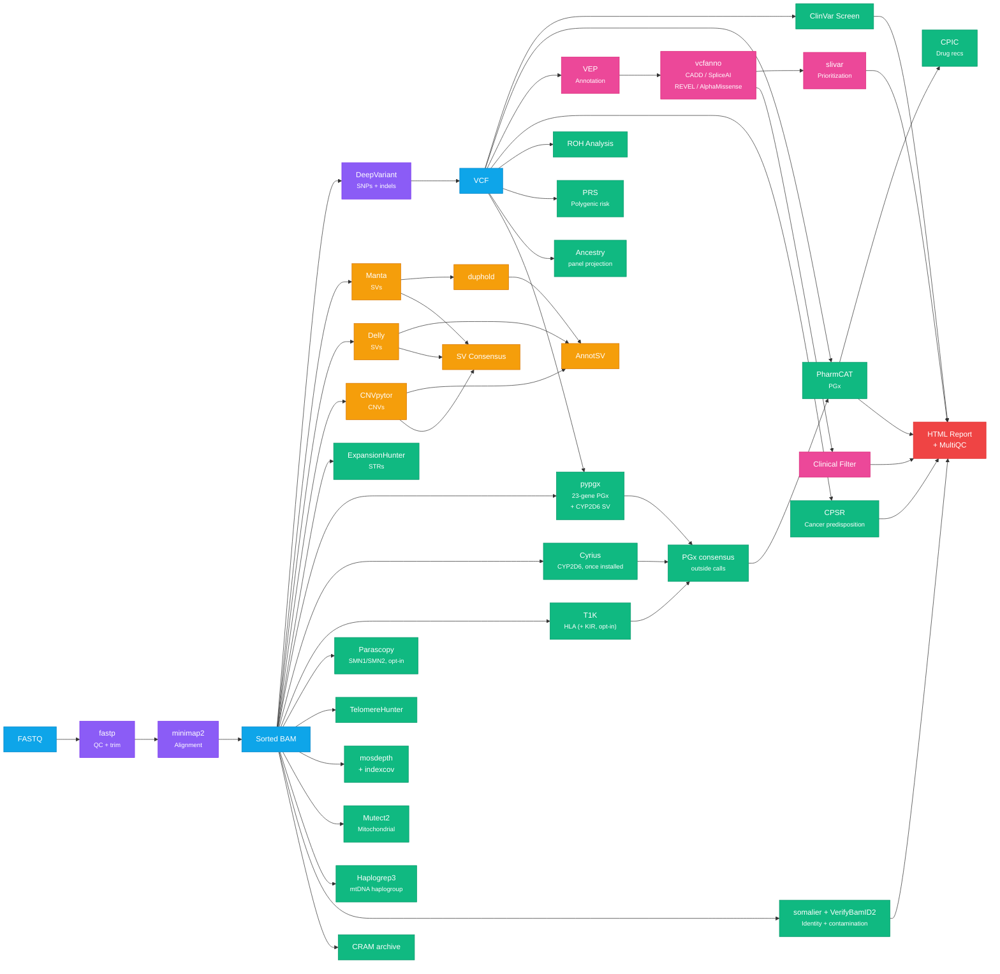

# Pipeline overview

## What You Get

| Category | What It Finds | Steps |
|---|---|---|
| **Variant Calling** | SNPs, indels, structural variants, copy number variants | 3, 4, 4b, 18, 19 |
| **Clinical Screening** | Pathogenic variants, carrier status, cancer predisposition (CPSR panels), SMN1/SMN2 copy number (opt-in), a couple's shared carrier risk (opt-in) | 6, 17, 35, 35b, 39 |
| **Pharmacogenomics** | Drug-gene interactions (23+ genes, CYP2C19, CYP2D6 SV, DPYD, etc.), with HLA-A/B from T1K (and, with `HLA_QC=true`, only when OptiType agrees) and CYP2D6 only when two callers agree | 7, 21, 27, 32, 36 |
| **Structural Variants** | Deletions, duplications, inversions, translocations (4 callers + consensus) | 4, 4b, 5, 15, 18, 19, 22 |
| **Functional Annotation** | Impact prediction for every variant (VEP + CADD, SpliceAI, REVEL, AlphaMissense) | 13, 30 |
| **Variant Prioritization** | Rare deleterious variants, compound hets, gene constraint filtering | 31 |
| **Repeat Expansions** | Huntington's, Fragile X, ALS and the other disorders at the 31 loci of ExpansionHunter's bundled catalog | 9, 9b |
| **Blood Groups** | ABO, RhD, RhCE, Kell, Duffy, Kidd, MNS, Lutheran, Diego, Dombrock, Colton and the platelet antigens HPA-1 to -5 and -15, predicted from the genome (opt-in) | 41 |
| **Ancestry & Haplogroups** | Mitochondrial haplogroup (with an mtDNA contamination check), Y-chromosome haplogroup (opt-in), consanguinity check, projection onto a 1000 Genomes reference panel, admixture fractions and a chromosome painting against an 80-population panel (opt-in) | 11, 12, 26, 26b, 37 |
| **Telomere Length** | Relative telomere content estimation from WGS reads | 10 |
| **Mitochondrial** | Heteroplasmy detection, mitochondrial disease variants | 12, 20 |
| **Polygenic Risk** | Scores for 13 common conditions and traits (CAD, T2D, cancers, blood pressure, lipids, etc.) with pgsc_calc; a percentile among the most similar ancestry group with the panel installed | 25 |
| **Quality Control** | Adapter trimming, coverage statistics, aggregated QC report, sex check, sample identity and contamination, SV filtering | 1b, 15, 16, 16b, 28, 33 |
| **Storage** | Alignments kept as a checked CRAM, about half the size of the BAM | 34 |
| **Traits** | Lactase persistence, caffeine, alcohol flush, bitter taste, earwax, pigmentation, APOE and other replicated variants, each row citing its primary paper | 42 |

## Pipeline Overview

### All Steps

| # | Step | Tool | Image variable | Required? |
|---|---|---|---|---|
| 1 | [ORA to FASTQ](01-ora-to-fastq.md) | orad | `orad` binary | Only for Illumina ORA files |
| 1b | [QC & Trimming](01b-fastp-qc.md) | fastp | `FASTP_IMAGE` | Recommended |
| 2 | [Alignment](02-alignment.md) | minimap2 + samtools | `MINIMAP2_IMAGE` + `SAMTOOLS_IMAGE` | Yes (if starting from FASTQ) |
| 3 | [Variant Calling](03-variant-calling.md) | DeepVariant | `DEEPVARIANT_IMAGE` | Yes |
| 4 | [Structural Variants](04-structural-variants.md) | Manta | `MANTA_IMAGE` | Recommended |
| 5 | [SV Annotation](05-annotsv.md) | AnnotSV | `ANNOTSV_IMAGE` | If step 4 run |
| 6 | [ClinVar Screen](06-clinvar-screen.md) | bcftools isec, then the cDNA read check (pysam) | `BCFTOOLS_IMAGE` + `PYPGX_IMAGE` | Yes |
| 7 | [Pharmacogenomics](07-pharmacogenomics.md) | PharmCAT | `PHARMCAT_IMAGE` | Yes |
| 8 | [HLA Typing](08-hla-typing.md) | T1K (+ OptiType with `HLA_QC=true`) | `T1K_IMAGE` (+ `OPTITYPE_IMAGE` + `SAMTOOLS_IMAGE`) | Optional |
| 9 | [STR Expansions](09-str-expansions.md) | ExpansionHunter | `EXPANSIONHUNTER_IMAGE` | Recommended |
| 9b | [STR Annotation](09b-stranger.md) | Stranger | `STRANGER_IMAGE` | If step 9 run |
| 10 | [Telomere Length](10-telomere-analysis.md) | TelomereHunter | `TELOMEREHUNTER_IMAGE` | Optional |
| 11 | [ROH Analysis](11-roh-analysis.md) | bcftools roh | `BCFTOOLS_IMAGE` | Recommended |
| 12 | [Mito Haplogroup](12-mito-haplogroup.md) | haplogrep3 + haplocheck | `HAPLOGREP3_IMAGE` + `HAPLOCHECK_IMAGE` | Optional (reads step 20's calls when they exist) |
| 13 | [VEP Annotation](13-vep-annotation.md) | VEP | `VEP_IMAGE` | Recommended |
| 14 | [Imputation Prep](14-imputation-prep.md) | bcftools | `BCFTOOLS_IMAGE` | Optional, opt-in (`IMPUTATION=true`) |
| 15 | [SV Quality](15-duphold.md) | duphold | `DUPHOLD_IMAGE` | If step 4 run |
| 16 | [Coverage QC](16-indexcov.md) | indexcov | `GOLEFT_IMAGE` | Recommended |
| 16b | [Coverage Stats](16b-mosdepth.md) | mosdepth | `MOSDEPTH_IMAGE` | Recommended |
| 17 | [Cancer Predisposition](17-cpsr.md) | CPSR | `PCGR_IMAGE` | Recommended |
| 18 | [CNV Calling](18-cnvpytor.md) | CNVpytor | `CNVPYTOR_IMAGE` | Optional |
| 19 | [SV Calling (Delly)](19-delly.md) | Delly | `DELLY_IMAGE` | Optional |
| 20 | [Mitochondrial](20-mtoolbox.md) | GATK Mutect2 | `GATK_IMAGE` | Optional |

#### Post-Processing Steps

These run after the core pipeline completes and combine outputs from earlier steps.

| # | Step | Tool | Image variable | Required? |
|---|---|---|---|---|
| 21 | [CYP2D6 Star Alleles](21-cyrius.md) | Cyrius | `PYTHON_IMAGE` | Runs by default once `setup.sh --cyrius` has installed it (non-commercial licence); skipped otherwise |
| 22 | [SV Consensus Merge](22-survivor-merge.md) | SURVIVOR | `SURVIVOR_IMAGE` | If two SV callers ran |
| 23 | [Clinical Filter](23-clinical-filter.md) | bcftools +split-vep | `BCFTOOLS_IMAGE` | If step 13 run |
| 24 | [HTML Report](24-html-report.md) | bash + bcftools | `BCFTOOLS_IMAGE` | Recommended |
| 25 | [Polygenic Risk Scores](25-prs.md) | pgsc_calc | `PGSC_UTILS_IMAGE`, `PLINK2_IMAGE` | Exploratory; percentiles need the ancestry panel |
| 26 | [Ancestry](26-ancestry.md) | pgsc_calc | `PGSC_FRAPOSA_IMAGE`, `PGSC_UTILS_IMAGE` | After `setup.sh --ancestry-panel` (runs inside step 25) |
| 26b | [Fine-Grained Ancestry](26b-ancestry-fine.md) | ADMIXTURE, Beagle, RFMix | `ADMIXTURE_IMAGE`, `BEAGLE_IMAGE`, `RFMIX_IMAGE` | Opt-in, after `setup.sh --ancestry-fine-panel` (ADMIXTURE: academic use; RFMix: academic research only) |
| 27 | [CPIC Recommendations](27-cpic-lookup.md) | Python + CPIC | `PYTHON_IMAGE` | If step 7 run |
| 28 | [MultiQC Report](28-multiqc.md) | MultiQC | `MULTIQC_IMAGE` | Recommended |
| 29 | [Somatic Variants](29-mutect2-somatic.md) | GATK Mutect2 | `GATK_IMAGE` | Experimental, opt-in (`SOMATIC=true`) |
| 30 | [Annotation Enrichment](30-vcfanno.md) | vcfanno | `VCFANNO_IMAGE` | If step 13 run |
| 31 | [Variant Prioritization](31-slivar.md) | slivar | `SLIVAR_IMAGE` | If step 13 run |
| 32 | [pypgx Pharmacogenomics](32-pypgx.md) | pypgx | `PYPGX_IMAGE` | Recommended |
| 33 | [Sample Identity and Contamination](33-sample-qc.md) | somalier + VerifyBamID2 | `SOMALIER_IMAGE` + `VERIFYBAMID2_IMAGE` | Recommended |
| 34 | [CRAM Archive](34-cram-archive.md) | samtools | `SAMTOOLS_IMAGE` | Optional, when the analysis is done |
| 35 | [Paralog Genes: SMN1/SMN2](35-paralogs.md) | Parascopy | `PARASCOPY_IMAGE` | Opt-in (`TOOLS=...,parascopy`) |
| 35b | [Paralog Genes from PacBio HiFi Reads](35-paralogs.md#step-35b-paralog-genes-from-pacbio-hifi-reads-paraphase) | Paraphase + Python | `PARAPHASE_IMAGE` + `PYTHON_IMAGE` | Opt-in (`TOOLS=...,paraphase`; PacBio HiFi BAMs only) |
| 36 | [PGx Consensus](36-pgx-consensus.md) | Python | `PYTHON_IMAGE` | Runs with step 7 when step 8, 21 or 32 ran |
| 37 | [Y-Chromosome Haplogroup](37-y-haplogroup.md) | Yleaf | `YLEAF_IMAGE` | Opt-in (`TOOLS=...,y_haplogroup`, after `setup.sh --yleaf-data`; male samples) |
| 38 | [Family Analysis](multi-sample.md#family-analysis-step-38-opt-in) | GLnexus + somalier + WhatsHap | `GLNEXUS_IMAGE` + `SOMALIER_IMAGE` + `WHATSHAP_IMAGE` (with `BCFTOOLS_IMAGE` + `PYTHON_IMAGE`) | Opt-in (a pedigree naming two or more samples, each with a gVCF; after `setup.sh --sample-qc-data`) |
| 39 | [Couple Carrier Screen](39-couple.md) | Python | `PYTHON_IMAGE` | Opt-in (a pedigree marking two samples as partners; after step 6 for both) |
| 40 | [Raw-Data Export](40-export-consumer.md) | Python | `PYTHON_IMAGE` | Opt-in (`TOOLS=...,consumer_export`, after `setup.sh --consumer-sites`; needs the gVCF) |
| 41 | [Blood Groups (predicted)](41-bloodtype.md) | samtools + Python | `SAMTOOLS_IMAGE` + `PYTHON_IMAGE` | Opt-in (`TOOLS=...,bloodtype`; RhD needs the BAM) |
| 42 | [Traits Panel](42-traits.md) | bcftools + Python | `BCFTOOLS_IMAGE` + `PYTHON_IMAGE` | Recommended (reads the gVCF of step 3) |

### What a default run covers

A default `./scripts/run-all.sh <sample> <sex>` runs **36 numbered steps**: 1b and 2 (only when there is no BAM yet), 3 (only when there is no VCF yet), 4, 5, 6, 7, 8, 9, 9b, 10, 11, 12, 13, 15, 16, 16b, 17, 18, 19, 20, 21, 22, 23, 24, 25, 26, 26b, 27, 28, 30, 31, 32, 33, 36 and 42. Steps 5, 8, 13, 17, 18, 32 and 33 are reported as skipped when their data is not installed (for 33, somalier's sites and VerifyBamID2's panel, which `setup.sh` installs), 21 when Cyrius is not installed (`setup.sh --cyrius`; non-commercial licence), 25 when no score file is, 26 (inside the PRS run of step 25) when the ancestry panel is not, 26b when its panel (`setup.sh --ancestry-fine-panel`) is not, 23, 30 and 31 when step 13 did not run, 36 (inside the PharmCAT stage) runs when step 8 or 32 did, and 42 is reported as skipped for a sample that starts from a VCF, unless it has a BAM too and a gVCF beside the VCF (the gVCF `run-all.sh` passes on). It ends with the summary report (`generate-report.sh`).

Off unless you ask for them: 35 (`TOOLS=...,parascopy`, after `setup.sh --parascopy-data`), 35b (`TOOLS=...,paraphase`, on a PacBio HiFi BAM), KIR typing in step 8 (`KIR=true`, after `setup.sh --kir-data`), OptiType beside T1K in step 8 (`HLA_QC=true`), 4b (`GRIDSS=true`), 14 (`IMPUTATION=true`), 29 (`SOMATIC=true`), 37 (`TOOLS=...,y_haplogroup`, after `setup.sh --yleaf-data`, male samples), 40 (`TOOLS=...,consumer_export`, after `setup.sh --consumer-sites`), 41 (`TOOLS=...,bloodtype`), the alternative callers 3a to 3d (`EXTRA_CALLERS=gatk,freebayes,strelka2,octopus`) and the caller comparison (`BENCHMARK=true`). Step 1 (ORA input) and the other alternative scripts (2a, 2b, 3e, 4a, 4c) run only by hand. Step 33 stops the run when somalier's sex from the reads differs from the declared one, as step 16 does (`--sex_check warn` logs it and goes on). Step 34 runs by hand, or in the Nextflow pipeline with `cram_archive` in `--tools`. Steps 38 and 39 work on a family, not one sample, so `run-all.sh` never runs them: run `38-family.sh` and `39-couple.sh` by hand with a pedigree, or give the Nextflow pipeline `--pedigree` (step 39 then runs for two samples the pedigree marks as partners, when `clinvar` is in `--tools`).

The [Nextflow pipeline](nextflow.md) runs the same chain from a samplesheet, from FASTQ (steps 1b, 2, 16 and 3) to the report, with the steps above that have a module.

The minimum useful run is steps 2, 3, 6 and 7 (alignment, variant calling, ClinVar, PharmCAT). Runtimes per step and for a whole run are on [Hardware and storage requirements](hardware-requirements.md#runtime-per-step).

#### Alternative Tools (Benchmarking)

No single variant caller is universally best. The pipeline includes alternative tools that output to separate directories so you can compare results without overwriting the defaults.

| Script | Tool | Alternative To | Output Directory |
|---|---|---|---|
| [02a](https://github.com/GeiserX/Personal-Genome-Pipeline/blob/main/scripts/02a-alignment-bwamem2.sh) | BWA-MEM2 | minimap2 (step 2) | `aligned_bwamem2/` |
| [03a](https://github.com/GeiserX/Personal-Genome-Pipeline/blob/main/scripts/03a-gatk-haplotypecaller.sh) | GATK HaplotypeCaller | DeepVariant (step 3) | `vcf_gatk/` |
| [03b](https://github.com/GeiserX/Personal-Genome-Pipeline/blob/main/scripts/03b-freebayes.sh) | FreeBayes | DeepVariant (step 3) | `vcf_freebayes/` |
| [04a](https://github.com/GeiserX/Personal-Genome-Pipeline/blob/main/scripts/04a-tiddit.sh) | TIDDIT | Manta (step 4) | `sv_tiddit/` |
| [03c](https://github.com/GeiserX/Personal-Genome-Pipeline/blob/main/scripts/03c-strelka2-germline.sh) | Strelka2 | DeepVariant (step 3) | `vcf_strelka2/` |
| [03d](https://github.com/GeiserX/Personal-Genome-Pipeline/blob/main/scripts/03d-octopus.sh) | Octopus | DeepVariant (step 3) | `vcf_octopus/` |
| [04b](https://github.com/GeiserX/Personal-Genome-Pipeline/blob/main/scripts/04b-gridss.sh) | GRIDSS | Manta (step 4) | `sv_gridss/` |
| [benchmark](https://github.com/GeiserX/Personal-Genome-Pipeline/blob/main/scripts/benchmark-variants.sh) | bcftools isec / hap.py | — | `benchmark/` |

See [docs/benchmarking.md](benchmarking.md) for how to run and interpret results, and [docs/tool-rationale.md](tool-rationale.md) for why each default was chosen.

